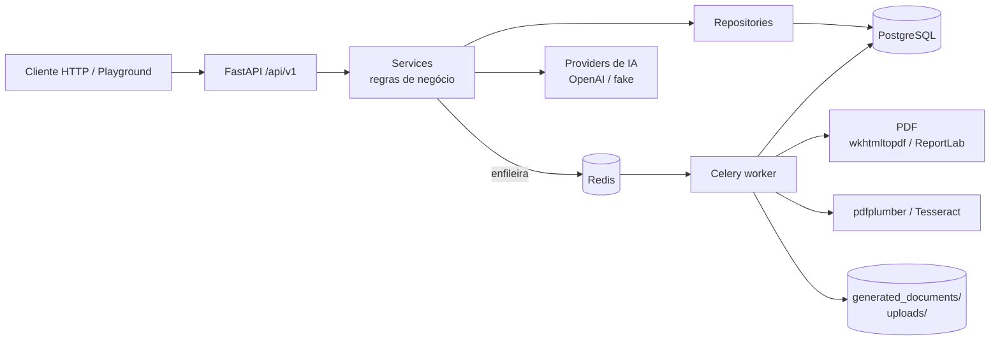

# Sistema Inteligente de Emissão de Minutas

[](https://github.com/augustoemiliano/Sistema-Inteligente-de-Emissao-de-Minutas/actions/workflows/ci.yml)

Backend corporativo em **FastAPI** para **geração e governança de minutas/contratos**. Usuários
cadastram **templates Jinja2**, geram minutas preenchendo variáveis, cada alteração vira uma
**versão imutável**, a minuta passa por um **workflow de aprovação** com papéis, o **PDF** é gerado
em fila (**Celery + Redis**), documentos enviados passam por **extração de texto/OCR**, uma camada
de **IA generativa (OpenAI)** sugere cláusulas e revisa textos — e tudo fica registrado em uma
**trilha de auditoria**.

## Funcionalidades

| Área | O que faz |
|------|-----------|
| **Autenticação** | JWT de acesso + refresh token opaco (hash no banco, rotação e revogação), logout, papéis `admin` / `editor` / `viewer` |
| **Templates** | CRUD de templates HTML + Jinja2 em **sandbox** (bloqueia SSTI) com autoescape; variáveis detectadas automaticamente; filtros pt-BR (`moeda`, `data`, `documento` para CPF/CNPJ); preview com marcação de variáveis faltantes; versionamento do template |
| **Minutas** | Criação a partir de template, validação de variáveis obrigatórias, **versões imutáveis** a cada edição, workflow `draft → in_review → approved → archived` com RBAC |
| **PDF** | Task Celery gera o PDF da versão; motor **wkhtmltopdf** (Docker) ou **ReportLab** (puro Python, fallback automático); download autenticado e auditado |
| **Uploads / OCR** | Upload de PDF/PNG/JPEG/TIFF validado por *magic bytes* e tamanho; texto extraído com **pdfplumber** e, para escaneados/imagens, **Tesseract** |
| **IA** | Sugestão de cláusulas e revisão (resumo, partes/valores/prazos, riscos) de minuta, upload ou texto livre. **OpenAI** com timeout e retry exponencial; **provider fake offline** quando não há chave |
| **Auditoria** | Login (inclusive falhas), CRUD de templates, minutas, transições, PDF gerado/baixado, uploads, chamadas de IA e mudanças de papel — com IP, user-agent, duração e filtros de consulta |
| **Operação** | `/health` (liveness), `/ready` (checa banco e Redis), `X-Request-ID` propagado nos logs, logs JSON em arquivo rotativo, Alembic, Docker Compose, CI |

## Arquitetura



| Camada | Responsabilidade |
|--------|-------------------|
| `app/api/` | Rotas HTTP, dependências de auth/RBAC, paginação, contexto de auditoria |
| `app/services/` | Casos de uso: templates, minutas, PDF, uploads/OCR, armazenamento seguro |
| `app/repositories/` | Queries e persistência (SQLAlchemy 2 async) |
| `app/models/` | Entidades ORM (tipos portáveis PostgreSQL/SQLite) |
| `app/schemas/` | Contratos Pydantic de entrada/saída |
| `app/ai/` | `providers/` (OpenAI, fake) e `services/` (prompts e casos de uso) |
| `app/tasks/` | Tasks Celery (geração de PDF, extração de texto) |
| `app/core/` | Configuração, segurança, logging, Celery |
| `app/templates/` | Layout HTML de impressão do PDF |

**Fluxo principal:** `login → template → POST /minutas → POST /minutas/{id}/pdf (Celery) → GET .../pdf → /audit`.

## Stack

Python 3.12 · FastAPI · Pydantic v2 · SQLAlchemy 2 (async) · Alembic · PostgreSQL 16 · Redis 7 ·
Celery 5 · python-jose (JWT) · bcrypt · Jinja2 (sandbox) · ReportLab / pdfkit + wkhtmltopdf ·
pdfplumber · Tesseract (pytesseract) · OpenAI SDK · tenacity · pytest · Ruff · Black · mypy ·
Docker Compose · GitHub Actions.

---

## Como rodar

### Opção 1 — Docker (stack completa, recomendado)

```bash
docker compose up --build
```

Sobe PostgreSQL, Redis, API e worker Celery. O entrypoint roda `alembic upgrade head` e o **seed
de demonstração**.

| O quê | URL |
|-------|-----|
| API | http://localhost:8010/api/v1 |
| Swagger / OpenAPI | http://localhost:8010/docs |
| Playground (UI de testes) | http://localhost:8010/playground/ |
| Postgres / Redis no host | `localhost:5437` / `localhost:6380` |

Para usar a OpenAI de verdade: `OPENAI_API_KEY=sk-... docker compose up --build`. Sem a chave, a
IA responde com o provider **fake** (offline, determinístico).

### Opção 2 — Local sem Docker (SQLite, sem Redis)

Bom para avaliar rapidamente: nada além de Python 3.12. As tasks rodam no próprio processo
(`CELERY_TASK_ALWAYS_EAGER=true`) e o PDF usa ReportLab.

```bash
python -m venv .venv
source .venv/bin/activate            # Windows: .venv\Scripts\activate
pip install -r requirements.txt -r requirements-dev.txt
cp .env.example .env                 # Windows: copy .env.example .env
```

Edite o `.env`:

```dotenv
SECRET_KEY=<gere com: python -c "import secrets; print(secrets.token_hex(32))">
DATABASE_URL=sqlite+aiosqlite:///./minutas.db
DATABASE_URL_SYNC=sqlite:///./minutas.db
CELERY_TASK_ALWAYS_EAGER=true
```

```bash
alembic upgrade head
python -m app.scripts.seed
uvicorn app.main:app --reload --port 8000
```

Docs em http://localhost:8000/docs e playground em http://localhost:8000/playground/.

### Opção 3 — Local com PostgreSQL e Redis do Compose

```bash
docker compose up -d postgres redis
cp .env.example .env                 # já aponta para 127.0.0.1:5437 e :6380
alembic upgrade head && python -m app.scripts.seed
uvicorn app.main:app --reload --port 8000
celery -A app.core.celery_app:celery_app worker -l info   # outro terminal (Windows: --pool=solo)
```

### Credenciais de demonstração (seed)

| Papel | E-mail | Senha | Pode |
|-------|--------|-------|------|
| admin | `admin@minutas.dev` | `Admin@12345` | tudo: aprovar, excluir templates, auditoria, gerenciar usuários |
| editor | `editor@minutas.dev` | `Editor@12345` | criar/editar templates e minutas, gerar PDF, uploads, IA, enviar para revisão |
| viewer | `viewer@minutas.dev` | `Viewer@12345` | somente leitura |

O seed também cria o template **"Contrato de Prestação de Serviços"**. Essas senhas são públicas —
não rode o seed em produção. Sem seed, o **primeiro** usuário registrado vira admin.

---

## Exemplos de requisição

```bash
API=http://localhost:8010/api/v1

# 1. Login
TOKEN=$(curl -s -X POST $API/auth/login -H 'Content-Type: application/json' \
  -d '{"email":"editor@minutas.dev","password":"Editor@12345"}' | jq -r .access_token)
AUTH="Authorization: Bearer $TOKEN"

# 2. Criar um template (variáveis são detectadas automaticamente)
curl -s -X POST $API/templates -H "$AUTH" -H 'Content-Type: application/json' -d '{
  "name": "Procuração simples",
  "category": "procuracoes",
  "content": "<h1>PROCURAÇÃO</h1><p>{{ outorgante }}, CPF {{ cpf | documento }}, nomeia {{ outorgado }}.</p>"
}'
# -> {"id": "...", "variables": ["cpf", "outorgado", "outorgante"], "version": 1, ...}

# 3. Gerar a minuta
curl -s -X POST $API/minutas -H "$AUTH" -H 'Content-Type: application/json' -d '{
  "title": "Procuração — Maria",
  "template_id": "<ID_DO_TEMPLATE>",
  "variables": {"outorgante": "Maria Silva", "cpf": "12345678901", "outorgado": "João Souza"}
}'

# 4. Gerar o PDF (202 + task_id; consulte GET /minutas/{id} até pdf_status=ready)
curl -s -X POST $API/minutas/<ID_DA_MINUTA>/pdf -H "$AUTH"
curl -s -H "$AUTH" -o minuta.pdf $API/minutas/<ID_DA_MINUTA>/versions/1/pdf

# 5. Nova versão (somente em draft) e workflow
curl -s -X PUT $API/minutas/<ID> -H "$AUTH" -H 'Content-Type: application/json' \
  -d '{"variables": {...}, "change_note": "Ajuste do outorgado"}'
curl -s -X POST $API/minutas/<ID>/status -H "$AUTH" -H 'Content-Type: application/json' \
  -d '{"status": "in_review"}'

# 6. IA: revisão da minuta e sugestão de cláusula
curl -s -X POST $API/ai/review -H "$AUTH" -H 'Content-Type: application/json' -d '{"minuta_id": "<ID>"}'
curl -s -X POST $API/ai/clauses/suggest -H "$AUTH" -H 'Content-Type: application/json' \
  -d '{"contract_type": "Locação residencial", "objective": "multa por atraso no aluguel"}'

# 7. Upload para OCR
curl -s -X POST $API/uploads -H "$AUTH" -F "file=@contrato-escaneado.pdf"

# 8. Auditoria (admin)
curl -s "$API/audit?resource_id=<ID_DA_MINUTA>" -H "Authorization: Bearer $ADMIN_TOKEN"
```

### Endpoints

| Método | Caminho | Papel |
|--------|---------|-------|
| GET | `/health`, `/ready` | público |
| POST | `/auth/register`, `/auth/login`, `/auth/refresh` | público |
| POST | `/auth/logout` · GET `/auth/me` | autenticado |
| GET / PATCH | `/users`, `/users/{id}` (papel e ativação) | admin |
| GET | `/templates`, `/templates/{id}` · POST `/templates/{id}/preview` | autenticado |
| POST / PATCH | `/templates`, `/templates/{id}` | editor, admin |
| DELETE | `/templates/{id}` (bloqueado se houver minutas) | admin |
| GET | `/minutas` (`?status=&template_id=&mine=`), `/minutas/{id}`, `/minutas/{id}/versions[/{v}]` | autenticado |
| POST / PUT | `/minutas`, `/minutas/{id}` (nova versão) | editor, admin |
| POST | `/minutas/{id}/status` (transições conforme papel) | editor, admin |
| POST | `/minutas/{id}/pdf[?version=N]` | editor, admin |
| GET | `/minutas/{id}/versions/{v}/pdf` | autenticado |
| POST · GET | `/uploads` · `/uploads`, `/uploads/{id}` (só os próprios, admin vê todos) | editor/admin · autenticado |
| POST | `/ai/clauses/suggest`, `/ai/review` | editor, admin |
| GET | `/audit` (`?action=prefixo&user_id=&resource_type=&resource_id=&since=`) | admin |

Workflow de minuta: `draft → in_review` (editor/admin) · `in_review → approved | draft` (admin) ·
`draft | approved → archived` (admin). Só minutas em `draft` podem ganhar novas versões.

---

## Variáveis de ambiente

Veja o [`.env.example`](.env.example) comentado. Principais:

| Variável | Padrão | Descrição |
|----------|--------|-----------|
| `ENVIRONMENT` | `development` | `production` desliga `/docs` e playground e recusa `SECRET_KEY` de exemplo |
| `SECRET_KEY` | — (obrigatória) | Chave do JWT, mínimo 32 caracteres |
| `DATABASE_URL` / `DATABASE_URL_SYNC` | — (obrigatórias) | URL async (API) e sync (Alembic/worker). PostgreSQL ou SQLite |
| `REDIS_URL`, `CELERY_BROKER_URL`, `CELERY_RESULT_BACKEND` | `redis://localhost:6379/0` | Fila do Celery |
| `CELERY_TASK_ALWAYS_EAGER` | `false` | `true` executa PDF/OCR no próprio processo (sem Redis/worker) |
| `CORS_ORIGINS` | vazio | Lista separada por vírgulas (não JSON) |
| `AI_PROVIDER` | `auto` | `auto` (OpenAI se houver chave, senão fake), `openai` ou `fake` |
| `OPENAI_API_KEY`, `OPENAI_MODEL`, `OPENAI_TIMEOUT_SECONDS` | vazio, `gpt-4o-mini`, `30` | Integração OpenAI |
| `PDF_ENGINE`, `WKHTMLTOPDF_PATH` | `auto`, vazio | `auto` usa wkhtmltopdf se existir, senão ReportLab |
| `TESSERACT_CMD`, `OCR_LANGUAGE` | vazio, `por` | OCR (opcional) |
| `UPLOAD_DIR`, `GENERATED_DOCUMENTS_DIR`, `LOG_DIR` | `uploads`, `generated_documents`, `logs` | Diretórios de artefatos (fora do Git) |
| `MAX_UPLOAD_SIZE_MB` | `10` | Limite de upload |
| `ACCESS_TOKEN_EXPIRE_MINUTES`, `REFRESH_TOKEN_EXPIRE_DAYS`, `BCRYPT_ROUNDS` | `30`, `14`, `12` | Sessão e hashing |

---

## Testes e qualidade

```bash
pytest -q            # SQLite temporário, Celery eager, IA fake — não precisa de serviços externos
ruff check app
black --check app
mypy app
```

Para rodar a suíte contra PostgreSQL, defina `TEST_DATABASE_URL` e `TEST_DATABASE_URL_SYNC`.

O **GitHub Actions** (`.github/workflows/ci.yml`) roda dois jobs: lint (Ruff, Black, mypy) + testes
em SQLite; e um job com **PostgreSQL** como service que executa `alembic upgrade/check/downgrade`,
o seed e a suíte de testes contra o Postgres.

## Segurança

- Senhas com **bcrypt**; refresh tokens opacos guardados só como hash SHA-256, com rotação e revogação;
  token de acesso é invalidado se o papel do usuário mudar.
- Login executa bcrypt mesmo para e-mail inexistente (sem enumeração por tempo) e falhas são auditadas.
- Templates são conteúdo de usuário: **Jinja2 `SandboxedEnvironment`** + `autoescape` +
  `StrictUndefined`; wkhtmltopdf roda com `--disable-local-file-access` e sem JavaScript.
- Uploads: tipo detectado por *magic bytes*, limite de tamanho em streaming, nome físico gerado pelo
  servidor (UUID). Todo acesso a disco passa por `safe_join`, que impede **path traversal**.
- `X-Request-ID` do cliente só é aceito em formato seguro (evita forjar linhas de log).
- `uploads/`, `generated_documents/`, `logs/`, `.env` e bancos SQLite ficam fora do Git.

**Para produção ainda seria necessário:** rate limiting no login, desativar o auto-registro público
(ou exigir convite), segredos em cofre, armazenamento de arquivos em objeto (S3) e proxy reverso
com TLS.

## Estrutura

```
.
├── app/
│   ├── ai/            # providers (openai, fake) e casos de uso de IA
│   ├── api/           # rotas e dependências (auth, RBAC, paginação)
│   ├── core/          # config, segurança, logging, celery
│   ├── db/            # engine/sessões e tipos portáveis
│   ├── models/        # User, AuditLog, DocumentTemplate, Minuta, MinutaVersion, DocumentUpload
│   ├── repositories/
│   ├── schemas/
│   ├── scripts/       # seed de demonstração
│   ├── services/      # templates, minutas, PDF, OCR, uploads, storage
│   ├── tasks/         # tasks Celery
│   ├── templates/     # layout HTML do PDF
│   └── tests/
├── alembic/           # migrações
├── docker/            # Dockerfile e entrypoint
├── playground/        # UI estática de testes (/playground em dev)
├── uploads/ generated_documents/ logs/   # artefatos de runtime (só .gitkeep versionado)
├── docker-compose.yml
├── requirements.txt / requirements-dev.txt
└── .env.example
```
