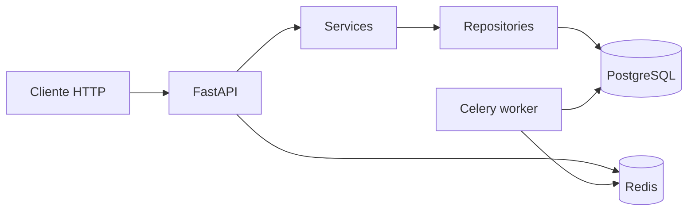

# Sistema Inteligente de Emissão de Minutas

Backend em **FastAPI** para geração e governança de minutas/contratos, com **PostgreSQL**, **Redis**, **Celery**, autenticação **JWT**, auditoria e base para **IA** (OpenAI), templates **Jinja2** e pipeline de documentos (PDF, OCR).

Trabalhe na **raiz do repositório** (onde estão `app/`, `docker-compose.yml` e `pyproject.toml`).

---

## Início rápido com Docker (recomendado)

Na pasta do projeto:

```bash
docker compose up --build
```

Aguarde o Postgres ficar healthy e o serviço `app` subir após `alembic upgrade head`.

| O quê | URL ou porta |
|--------|----------------|
| API (host) | **http://localhost:8010** (mapa `8010 → 8000` no container) |
| OpenAPI (Swagger) | http://localhost:8010/docs |
| Playground (testes visuais em dev) | http://localhost:8010/playground/ |
| Postgres (host) | `localhost:5437` → `5432` no container |
| Redis (host) | `localhost:6380` → `6379` no container |

**Atenção:** a API **não** escuta na porta 8000 no seu máquina quando você usa só o Compose acima; use **8010**, senão o navegador mostra *connection refused*.

O entrypoint da API executa `alembic upgrade head` antes do Uvicorn. O worker **Celery** sobe em paralelo (útil para filas; para só exercitar auth/health ele pode ficar ocioso).

---

## Playground e CORS

- Em ambiente **de desenvolvimento** (`ENVIRONMENT=development`), a UI estática do **playground** é servida em **`/playground/`** pelo próprio FastAPI (mesma origem que `/api/v1`, sem depender de CORS para essa página).
- **`CORS_ORIGINS`** no `.env` / Compose é uma **lista separada por vírgulas** (ex.: `http://localhost:3000,http://localhost:8010`). **Não** use JSON tipo `["http://..."]` — o carregamento das settings falha.

---

## Execução local (Python na máquina)

Útil para depurar com breakpoint; você precisa de **PostgreSQL** e **Redis** acessíveis (por exemplo só infra via Docker).

### 1. Subir só Postgres e Redis

```bash
docker compose up -d postgres redis
```

### 2. Ambiente virtual e dependências

```bash
python3 -m venv .venv
source .venv/bin/activate   # Windows: .venv\Scripts\activate
pip install -r requirements.txt
pip install -r requirements-dev.txt   # opcional: ruff, black, mypy
cp .env.example .env
```

### 3. Ajustar `.env`

- **`SECRET_KEY`**: pelo menos 32 caracteres (ex.: `openssl rand -hex 32`).
- **`DATABASE_URL`** / **`DATABASE_URL_SYNC`**: com o Compose acima, use **`127.0.0.1:5437`** e o banco `minutas_db` (usuário/senha `minutas`), como no `.env.example`.
- **`REDIS_URL`** (e URLs do Celery): com o Compose, **`127.0.0.1:6380`**.
- **`CORS_ORIGINS`**: inclua `http://localhost:8000` se for abrir o Swagger ou um front na porta 8000 enquanto o Uvicorn local escuta aí.

### 4. Migrações e servidor

```bash
alembic upgrade head
uvicorn app.main:app --reload --host 0.0.0.0 --port 8000
```

- Documentação: http://localhost:8000/docs  
- Playground: http://localhost:8000/playground/  
- Em **produção** (`ENVIRONMENT=production`), `/docs`, `/redoc` e o playground ficam desligados na API.

### Ferramentas no sistema (opcional)

Para PDF/OCR alinhados ao `requirements.txt`, em Debian/Ubuntu um conjunto típico é: `wkhtmltopdf`, `tesseract-ocr`, `tesseract-ocr-por`, `poppler-utils`. A imagem Docker já inclui esses pacotes (base **Debian Bookworm**, compatível com `wkhtmltopdf` via apt).

---

## Docker (detalhe)

- **Build:** `docker/Dockerfile`, contexto na raiz do projeto; pasta **`playground/`** é copiada para a imagem.
- **Volumes:** `./uploads`, `./generated_documents`, `./logs` montados no container para persistir artefatos entre reinícios.

Comando único já citado no início rápido:

```bash
docker compose up --build
```

Para apenas API + banco + Redis (sem worker):

```bash
docker compose up --build postgres redis app
```

---

## Visão geral

O sistema expõe APIs em **`/api/v1`**, persiste em PostgreSQL com **SQLAlchemy 2 (async)** e **Alembic**, usa **Redis** com **Celery** para trabalhos assíncronos, e inclui correlação **`X-Request-ID`** nos logs.

---

## Arquitetura (clean + camadas)

| Camada | Responsabilidade |
|--------|-------------------|
| **api/** | HTTP, OpenAPI, deps de auth/DB |
| **services/** | casos de uso, transações de negócio |
| **repositories/** | persistência e queries |
| **models/** | entidades ORM |
| **schemas/** | Pydantic (entrada/saída) |
| **core/** | config, segurança, logging, Celery |
| **ai/** | (etapas futuras) provedores e serviços de IA |
| **tasks/** | tarefas Celery |



---

## Stack

- Python **3.12+**, FastAPI, Pydantic, Uvicorn  
- PostgreSQL, SQLAlchemy 2 async, **psycopg** (async) + **psycopg2** (Alembic)  
- Redis, Celery, JWT (access) + refresh opaco com hash no banco  
- bcrypt (senhas; entrada normalizada para evitar divergência ao colar senha com quebras de linha/BOM nas pontas), tenacity  

---

## Endpoints principais (ETAPA 1)

| Método | Caminho | Descrição |
|--------|---------|-----------|
| GET | `/api/v1/health` | Liveness |
| GET | `/api/v1/ready` | Readiness simplificado |
| POST | `/api/v1/auth/register` | Registro (primeiro usuário ativo vira **admin**) |
| POST | `/api/v1/auth/login` | Login — access + refresh |
| POST | `/api/v1/auth/refresh` | Renova access + refresh (rotação) |
| GET | `/api/v1/auth/me` | Perfil autenticado |
| GET | `/api/v1/auth/admin/ping` | Smoke **admin-only** (RBAC) |

---

## Estrutura de pastas (raiz)

```
.
├── app/
│   ├── api/
│   ├── core/
│   ├── db/
│   ├── models/
│   ├── schemas/
│   ├── repositories/
│   ├── services/
│   ├── ai/
│   ├── utils/
│   ├── tests/
│   └── main.py
├── playground/           # UI estática de testes (/playground/ em dev)
├── uploads/
├── generated_documents/
├── logs/
├── docker/
├── alembic/
├── docker-compose.yml
├── docker/Dockerfile
├── requirements.txt
├── requirements-dev.txt
├── .env.example
└── README.md
```

---

## Testes e qualidade

Com Postgres de teste em **`127.0.0.1:5437`** (veja `app/tests/conftest.py`) ou ajustando env:

```bash
source .venv/bin/activate
pytest
ruff check app
black --check app
mypy app
```

---

## Segurança (resumo)

**Já presente:** bcrypt, JWT, refresh com hash e rotação, papéis `admin` / `editor` / `viewer`, auditoria em eventos de auth, `X-Request-ID`.

**Produção típica:** rate limiting, MFA, segredos em vault, headers e proxy reverso adequados.

---

## Roadmap (etapas)

1. CRUDs de clientes e minutas com versionamento.  
2. Motor Jinja2 + PDF + artefatos versionados.  
3. Camada IA com timeouts/retries.  
4. Filas para operações pesadas; dead-letter e idempotência.  
5. Upload, pdfplumber + OCR.  
6. Testes de integração amplos (ex.: Testcontainers).  
7. Observabilidade e hardening.

---

Licença: defina conforme o repositório. Comentários no código apenas onde agregam contexto de negócio ou decisões conscientes.
